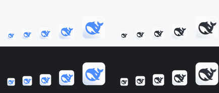

# dsh-toolbox · 自用工具库

DSH 桌面端（DeepSeek Harness）的个人工具箱插件，这些事：

| 功能 | 位置 |
| --- | --- |
| **一键重启 DSH** | 窗口标题栏图标按钮（贴着系统最小化/最大化/关闭按钮左侧）+ 设置页 + 可选托盘小程序；点击后二次确认 |
| **检查桌面端更新** | 标题栏图标按钮，有更新时变绿，鼠标悬停显示「当前版本 → 最新版本」 |
| **Enter / Ctrl+Enter 发送** | 设置 → 通用里的独立一行，以及插件设置页；输入框发送按钮旁常驻一行浅色小字说明当前是哪种 |
| **AI 重命名会话** | 左侧会话列表里右键某个会话 →「AI 重命名」：用该会话的模型（思考关闭）按对话内容重新生成标题 |
| **打开 DSH 设置页** | 标题栏最左边的齿轮按钮，以及可选托盘菜单的第 4 项（等同侧边栏底部的「设置」、`Ctrl+,`） |
| **启动时自动最大化**（默认开） | 设置页开关；也可「立即最大化」当场试一次（走系统接口，不依赖外壳） |
| **托盘打开/隐藏窗口** | 可选托盘小程序的第 1 项，或**双击托盘图标** |
| **托盘里关闭 DSH** | 可选托盘小程序的右键菜单，带二次确认 |

所有按钮都是图标（内联 SVG，无第三方图标依赖），没有文字按钮。

> **消费金额已拆分为独立插件 [`dsh-cost`](../dsh-cost)**：输入框下方的金额胶囊、金额明细、子代理分摊、计价来源与货币设置都在那里。本插件不再包含任何计费代码，也不再读写 `prices.json`；第一次启动 `dsh-cost` 时它会自动接管原来那份价格缓存与货币设置。

---

## 安装

```powershell
# 在 DSH 里：设置 → 插件 → 安装，填入目录或包名
E:/Data/Project/DeepSeekHarness/DSH-Homemade-Plugins/dsh-toolbox
```

或用命令行等价的方式（与同目录的 `dsh-windows-notify`、`dsh-text-manager` 一致）：

```jsonc
// ~/.dsh/profiles/desktop/package.json
"dependencies": {
  "dsh-toolbox": "file:E:/Data/Project/DeepSeekHarness/DSH-Homemade-Plugins/dsh-toolbox"
},
"dsh": { "profile": { "bundles": [ /* … */ "dsh-toolbox" ] } }
```

然后在 profile 目录执行 `pnpm install`。

> **改完代码要重启才生效。** 载入器会缓存已 import 的模块，`file:` 依赖虽然在
> `node_modules` 里是软链接（改文件立即指到新代码），但已加载的插件实例不会重新
> import。这正是本插件提供「重启」的原因：改完点一下标题栏的重启按钮即可。

---

## 1. 重启 DSH

### 为什么是「先起助手，再退出」

DSH 桌面端的进程结构决定了插件**不能**直接请外壳重启：

- Electron 主进程是父进程，DSH 的 Node 半边（Host）是它的 IPC 子进程；
- 主进程不对外开放插件扩展点，而且它**校验**子进程发来的每一条 IPC 消息——不认识的
  类型会被当成「Host 异常」并直接终止整个应用（`isDesktopHostEvent`）；
- 子进程自行退出时，主进程会把它当作崩溃，弹出恢复对话框，而不是重新启动。

所以插件的做法是：

1. 以 **detached 方式**启动一个重启助手（`scripts/relaunch.mjs`，用 DSH 自己的可执行文件
   以 Node 模式运行），助手第一件事就是写出「就绪标记」文件；
2. Host 轮询该标记，**只有看到就绪才**结束 Electron 主进程（`process.kill(ppid)`）；
3. 主进程消失 → 子进程的 IPC 断开 → DSH 的 Node 半边执行自己的
   `shutdown(0)`，把会话日志与后台任务落盘后退出；
4. 助手等到「应用进程消失」且「HTTP 端口释放」后，用**清理过的环境**重新启动同一个
   可执行文件。

因此不会出现「关掉起不来」：助手没就绪就直接拒绝重启并把原因报给界面。

### 助手为什么是 Node 而不是 PowerShell（两个真踩到的坑）

最初助手是 `relaunch.ps1`，结果是**每次重启都被网关拒绝**（`toolbox.log` 里写着「重启助手未
在 4 秒内就绪」），因为：

1. **`detached: true` 会让 Windows PowerShell 立刻退出。** Node 在 Windows 上用
   `detached` 会给子进程 `DETACHED_PROCESS`，也就是「没有控制台」；Windows PowerShell
   5.1 在无法附着控制台时会**立即以 code 0 退出**，既不写标记也不写日志。已实测复现：
   同一脚本 `detached: false` 正常，`detached: true` 连一行日志都没有。Node 能忍受没有
   控制台，所以「脱离父进程」这件事在 Node 下才真正成立。
2. **重启后的应用绝不能继承 `ELECTRON_RUN_AS_NODE=1`。** Host 自己带着这个变量运行，
   若助手原样继承，启动的 Electron 会以 Node 模式跑（等于什么都没开）。现在
   `buildRelaunchEnv()` 显式剔除它，并有单元测试盯着这个不变量。

主进程结束后，Host 可能还在落盘、暂时占着 HTTP 端口；助手会先等端口释放，若仍被占用才
**只**清理「与被重启的可执行文件同名」的残留进程（端口确实被别的程序占用时它不会动手，
并在日志里说明），避免新实例撞上「另一个 DSH 实例正在运行」。日志在
`~/.dsh/toolbox/logs/relaunch.log`。

**代价（界面上也如实提示）**：Electron 自己的退出收尾（窗口位置、更新日志）不会执行；
进行中的对话与后台任务会被中断；DSH 自己的数据在第 3 步已落盘。

### 关于托盘

**DSH 自带托盘图标和它的右键菜单由 Electron 外壳创建与拥有，插件无法往里加菜单项**
（没有插件扩展点，且 IPC 白名单不可扩展）。因此本插件提供的是：

- 标题栏图标按钮（默认开启）；
- 设置页里的「立即重启」，以及「启动窗口」「托盘小程序」等开关；
- **可选**的「托盘小程序」（默认关闭）：一个并排的独立托盘图标。右键菜单从上往下固定为：

  | # | 菜单项 | 行为 |
  | --- | --- | --- |
  | 1 | 打开/隐藏 DeepSeek Harness | 窗口在屏幕上就隐藏，隐藏/最小化就恢复并切到前台（**双击图标同一行为**） |
  | 2 | 重启 DeepSeek Harness | 二次确认后重启（见上一节） |
  | 3 | 检查更新 | 立即检查桌面端更新 |
  | 4 | 设置 | 打开 DSH 自己的设置页（不碰窗口，只让页面去开，见第 6 节） |
  | 5 | 关闭 DeepSeek Harness | 二次确认后关闭，不会自动重开 |

  DSH 退出时托盘图标自己消失。开启方式：设置 → 自用工具库 → 托盘小程序（**想移除图标就
  关掉这个开关**）。它仍然必须走 PowerShell（WinForms 的 `NotifyIcon`），因此**不能**用
  `detached`（同上：PowerShell 需要控制台），并且进程一旦立刻退出就会把原因写进
  `~/.dsh/toolbox/logs/tray.log` 并显示在设置页，而不是安静地「看起来在运行」。

托盘图标直接沿用 DSH 自己的图案，**只换色**：同样的鲸鱼、同样的浅色圆角底板，墨水从深墨色
改成插件的蓝色——这样在通知区域里一眼能分辨出哪个是插件（我自己画的那版鲸鱼还是太像了）。
图案由 `tools/make-icon.py` 从安装目录的 `resources/icon.png` 取图，按亮度把「墨水」重绘成
`ACCENT` 色（边缘按覆盖度混合，所以描边依旧平滑），再生成 9 个尺寸的 `.ico`；换颜色只要改
那个常量再重跑。左边是换色后的插件图标，右边是 DSH 自带托盘图标（16/20/24/32/48，浅色与
深色两种背景）：



> 图案归属说明：鲸鱼是 DeepSeek 的标识，这里按你的要求做了本机自用改色。改色不改变归属——
> 自己留着用没问题，对外分发前请换成自己的图案。

托盘进程要回调插件的 HTTP 路由，所以它拿到的地址必须是 **http**：页面自己的来源在桌面端是
`dsh-app://app`，而 PowerShell 根本不能向这个协议发请求（实测报错正是「无法识别该 URI 前缀」，
`Invoke-RestMethod` 直接失败）——于是托盘的**每一个**菜单动作（重启/检查更新/设置/关闭）都
是坏的，不只是设置。现在这个地址由 Host 从**请求本身**的 Host 头取得（回环围栏已经保证了
它的可信），页面上报的值只当兜底，且校验必须是 http，否则托盘会拒绝启动并说明原因。

打开/隐藏为什么由**托盘进程自己**做，而不是转给 Host：Windows 只在调用者拥有前台窗口时才
允许它把别人的窗口提到最前，而「用户点了这个图标」正是这份权限的来源；转给 Host 会出
「窗口显示了但没到前台」。所以托盘的 Windows API 调用与最大化助手共用
`scripts/appwindow.ps1`，但**在托盘自己的进程里执行**。

隐藏用的是 `SW_HIDE`、恢复用的是 `SW_SHOW`（而不是 `SW_RESTORE`）：后者会把最大化窗口降回
普通尺寸，而前者保持隐藏时的尺寸与位置——实测「最大化 → 隐藏 → 显示」之后仍是最大化。
窗口被隐藏时依然能被枚举到（判断依据是尺寸/标题/可见性排序，不要求可见），所以一定能再
显示出来；托盘也只看应用进程是否还在，不会因为窗口隐藏就退出。

「关闭 DSH」为什么需要确认、又为什么不是 `app.quit()`：`app.quit()` 只有 Electron 主进程
能调，插件唯一可用的杠杆与重启相同——结束主进程，让 DSH 的 Node 半边执行自己的
`shutdown(0)` 落盘退出；区别只是**不再安排重启**。托盘里的这一项因此带一个确认框，并
明确写出「不会自动重新打开、进行中的任务会中断」。

语音之外的另一种替代路径：标题栏菜单栏（DSH 在 Windows 上注入的「应用/编辑」按钮）
里本来就有「退出」，配合任意方式重新启动即可。

---

## 2. 检查桌面端更新

- **当前版本**：Desktop 的 Node 半边拿不到 `app.getVersion()`，所以版本从安装目录读
  ——优先读 `resources/app.asar/package.json`（Electron 的 `fs` 经 asar 补丁接管后这是
  一个可读的虚拟路径），退回到自己解析 asar 头部，再退回到 `resources/app/package.json`。
- **更新源**：读 `resources/app-update.yml`（electron-builder 写给这个安装的 feed），
  按它声明的 provider/url/channel 取 `<channel>.yml`，再用语义化比较判断是否更新。因此
  检查结果与官方更新器一致，而不是写死一个地址。
- **颜色与提示**：有更新时按钮变绿，悬停提示「当前 x → 最新 y」；点击时若有更新则交给
  官方更新弹窗（`dshDesktop.updates.open()`）执行下载安装，否则做一次静默检查。
- 后台按设置里的间隔（默认 6 小时）自动检查一次。

---

## 3. Enter / Ctrl+Enter 发送

不替换输入框，只**改写一次按键**：

- `Ctrl+Enter`（macOS 是 `⌘+Enter`）→ 阻止原事件，向编辑器重放一次**不带修饰键的
  Enter**，也就是 DSH 自己定义的「发送」；
- `Enter` → 阻止原事件，重放一次 **Shift+Enter**，也就是 DSH 自己定义的「换行」；
- `Shift+Enter`、`Alt+Enter`、输入法合成中的 Enter、非输入框的编辑器一律不碰。

这样联想词弹窗、忙碌队列（排队/插话）、输入法都继续由 DSH 自己决定。默认仍是 DSH 的
「回车发送」。

---

## 4. AI 重命名会话（右键会话名）

在左侧会话列表里右键任意一个会话，菜单里会多出一行「AI 重命名」。点它就用**这个会话自己的
模型**重新生成标题，并直接写进会话日志——不满意再点一次即可。

「人类文字」有两种：你自己发的消息（`source.kind === 'user'`），以及**目标轮次**
（`source.kind === 'goal'`）里你创建目标时写的那句 objective。后者是 DSH 自带标题服务不认的
那一种——用目标开的会话（例如 Monopoly OfCthulhu 那个）在侧栏里没有标题，只剩工作区名；本插件
会把 `<goal_round>` 包装里的 objective 解出来单独发送，包装里的续跑指令一个字都不进请求。

### 复用 DSH 已有的三条通道，不自己发明

| 需要的能力 | 用的东西 | 为什么 |
| --- | --- | --- |
| 会话行右键菜单 | `sidebar.workspaces.session.menu.item` slot | 外壳的原生扩展位，`重命名`/`Fork`/`归档` 就挂在这里；顺序取 350，正好落在 fork(300) 与 archive(400) 之间 |
| 落标题 | `ctx.sessionTitle.rename(session, title)` | 追加 `session/title` 事件（`source: user`）。它与手动改名是**同一机制**，所以标题会被「钉住」，正在跑的自动命名不会覆盖它；侧边栏靠原有数据流自己刷新 |
| 调模型 | `ctx.llm.stream({ ..., purpose: 'session-title', reasoningEffort })` | `purpose` 只负责归因；**「关闭思考」必须显式发**：先用 `ctx.llm.resolveModelInfo` 问这个模型公布哪些档位，取最便宜的一档（`efforts[0]`，通常是 `off`）传给 `stream`。DSH 自己的标题 provider 也是这么做的 |
| 模型的来源 | 待用选择 → 会话自己的 `request/header` → 部署默认模型 | 与会话控制器选下一轮模型的口径一致，也就是「当前这个会话用的模型」 |
| 看到的会话内容 | DSH 自己的 `turnOutline` 投影（`ctx.sessionProjections.stateOf(session, 'turnOutline')`） | 它已经为**每一轮**折好了有界预览：该轮首条人类提示词（≤50 字）与该轮最后的助手回复（≤120 字），注入上下文与工具结果已被排除。等于一份现成的「目录」，不用本插件自己扫日志。投影不存在时退回直接读日志，行为与没有它时完全一致 |

打开历史会话也能用：先走 Typert 的公开 `agent` lookup（会按需恢复持久化会话），拿不到才退回
`ctx.sessions`（只认活着的会话）。

### 挑哪些轮次：三种策略，同一个字节预算

预算默认 **4 KiB**（与 DSH 自带的标题调用一致），设置页可调 1–24 KiB。规则按顺序试：

| 策略 | 何时用 | 实际覆盖面 |
| --- | --- | --- |
| `all` | 整个大纲装得下 | **7 轮**（一轮完整预览 = 546 字节；7 轮 3937 字节，第 8 轮超） |
| `sample` | 轮次太多 | 首轮 + 末轮**必选**，中间**均匀随机抽**到装满（4 KiB 约 7 轮） |
| `prompts` | 连「首末 + 一条回复预览」都装不下 | 丢掉助手回复预览，只发提示词——4 KiB 能覆盖 **十几到几十轮**（1 KiB 时约 5 轮） |

为什么中间用**随机**而不是某条规则：任何「哪一轮重要」的规则都得先知道什么才叫重要，说错了
就是系统性偏差；均匀随机在期望上不需要这个判断，代价是同一会话两次生成可能不同——这也是
「再点一次会看到另一个角度」的来源。首末必选是因为**位置**本身就带信息：首轮是意图，末轮是
结论。

单条超长时仍然按 Unicode 码点保留**结尾**（用户现在问的正是结尾）。因为轮次预览本身有上限，
**开销与对话长度基本无关**：5 万 token 的长会话和刚开的会话都是同一个量级。

实测阈值可以用 `node tools/title-budget-report.mjs` 自己打印（这也是我发现自己第一次估错
三倍的依据——那时以为 4 KiB 能装 20+ 轮完整预览）。

| 组成 | 量 |
| --- | --- |
| system 提示词 + JSON 框架 + 轮次列表 | ~150 tokens |
| 选中的轮次（4 KiB 中文约 1.3K 字） | ~950–1050 tokens |
| 输出标题（上限 64 tokens，实际十几） | ~15 tokens |
| 思考/推理 | **0**（已经显式要了模型最低档；只有模型根本不提供关闭档时才会跑到 1024 上限里，见下） |

折成钱（`deepseek-flash`）：空闲时段约 **¥0.0012/次**，高峰约 ¥0.0017/次；若模型是
`deepseek-v4-pro` 则约 ¥0.012–0.025/次。参考量级：DSH 正常一轮对话通常就是 8K–20K 输入
tokens，所以这一下约等于主对话的 5%–10% 一轮，而且**它不进主上下文**，不会让后续每一轮都
多付钱。

每次调用（包括被拒绝的调用）都会写一行审计到 `~/.dsh/toolbox/logs/toolbox.log`，含
`source`、`strategy`、`totalTurns`、`sampledTurns`、`inputBytes`、`inputTokens`、
`outputTokens`、`reasoningEffort`、`maxOutputTokens`、`model`——所以「4 KiB 到底够不够」
可以用真实数据回答，不用估。

### 几个必须写下来的坑

- **不能直接用 `sessionTitle.refresh()`**：默认的 `session-title-first-prompt-llm` 即使手动
  刷新也**只挑第一条人类消息**，于是经常「总结」出和原来几乎一样的标题。所以这里自己按
  「最新优先」挑消息，只是复用它的请求形状与 `purpose`。
- **`reasoningEffort` 必须显式传，而且只能传模型公布过的档位**：`purpose: 'session-title'`
  在 0.2.1-rc.3 已经不再被适配器翻译成「思考关闭」（更早的版本里有那行
  `options.purpose === "session-title" ? "off" : …`，现在没有了）。不传就落到模型默认档
  （`deepseek-flash` 是 `high`），64 个输出 token 会先被推理吃光，以 `max-tokens` 结束、一个字
  都拿不到——**2026-10-30 那两处「AI 重命名不起效」就是这么来的**。现在的做法是
  `llm.resolveModelInfo()` 拿到 `reasoning.efforts`，取第一档（适配器按从省到贵排序，通常就是
  `off`）显式发送；模型没公布过档位就一个字段都不发（否则会被判
  `UNSUPPORTED_REASONING_EFFORT`）；最低档不是 `off` 时把输出上限从 64 抬到 1024，给推理留地方。
  审计行里现在有 `reasoningEffort` 与 `maxOutputTokens` 两个字段，失败时可以直接看出是不是这一层。
- **目标会话（goal）没有 `user/message`**：`source.kind === 'goal'` 的轮次是驱动层合成的
  `<goal_round>` 包装，objective 以 JSON 字符串字面量放在里面。DSH 自带的标题服务只认
  `kind === 'user'`，所以这类会话在侧栏里没有标题；本插件解出 objective 当作人类文字参与挑选，
  并且同一段 objective 只发一次（256 轮的目标会话不会把预算全花在重复句子上）。
- **改名要在生成之后重新确认一次**：生成前记下标题的 `eventSeq`，生成后如果它变了（用户手动
  改名、或又点了一次），这一次的结果**直接丢弃**并回报「已被改动」，绝不覆盖新的意图。
- **`block-end` 是权威的**：流式组装时同一个 index 的 `text-delta` 累加，遇到 `block-end`
  则用它的文本**替换**而不是追加，否则标题会重复两遍。
- **菜单行的反馈必须留得住**：以前选中菜单项会立刻关菜单，而结果只渲染在那一行上，于是失败时
  屏幕上什么都不变——看起来就是「不起效」。现在点完**不关菜单**：「正在生成…」「标题已更新
  ○○」以及失败原因都留在原地，4 秒后自动恢复，鼠标移开或点别处照常关闭；请求进行中该行禁用，
  连点两次不会花两次钱。
- **`session/title-llm-request` 与 `session/title` 都写进会话日志**，所以模型看到了什么、
  用了哪个路由，事后可以逐条核对。
- **`@deepseek-ai/dsh-client-ui-primitives` 只能 `require`，绝不能写进 `inject`**：它是
  loader 的平台种子（`__ModuleLoader__.create({ staticModules })` 里就有它），`require`
  一定拿得到；而 `inject` 的每一项都是 **Cordis service**，写包名等于让这个 fiber 永久等待
  一个没人提供的服务——整个 web boot 会以
  「1 entry did not activate / dsh-toolbox: pending (waiting for service: …)」失败，所有插件
  一个都挂不上（2026-10-13 就是这么炸的）。`package.json` 里的 `dsh.client.inject` 是另一回事
  （模块加载顺序），这里同样不需要它。

---

## 5. 启动时自动最大化（默认开启）

DSH 的外壳同样没有给插件留窗口状态的扩展点（页面无法调整一个不是自己打开的窗口，
preload 的 `dshDesktop` 也不暴露窗口尺寸），所以本插件走系统接口：`scripts/maximize.ps1`
用 `user32.dll` 按进程 id 找到 DSH 自己的可见顶层窗口，调用 `ShowWindowAsync(SW_MAXIMIZE)`
——等同于用户双击标题栏。窗口部分的 Windows API 与托盘共用 `scripts/appwindow.ps1`。

- **只对已经显示出来的窗口生效**：Host 比窗口更早启动，强行让隐藏窗口显示会抢在 DSH 自己
  的时序之前闪出白屏；脚本因此会轮询等待窗口可见（默认最多 30 秒）再动手。
- 每次 DSH 启动（含由本插件重启）都会执行；设置里可关闭，也可「立即最大化」当场试一次。
- 是否成功、以及为什么没成功，都写在 `~/.dsh/toolbox/logs/window.log` 并显示在设置页。
- 仅 Windows 桌面端；`dsh web` 下该选项会自动显示为不支持。

已实测：对运行中的 DSH 窗口执行后 `IsZoomed=True`。

---

## 6. 打开 DSH 设置页（标题栏齿轮 + 托盘「设置」）

标题栏最左边有一个齿轮按钮，点它打开 **DSH 自己的设置页**（和侧边栏底部的「设置」、
`Ctrl+,` 完全同一个面板，本插件的设置在那一页的「自用工具库」里）。托盘菜单第 4 项同样。

**为什么不能直接调用一个「打开设置」的接口**：客户端服务目录里没有这个服务；承载设置面板的
`sidebar.settings` 是**单例**席位（往里注册会顶掉外壳自己的按钮），而面板的开关状态是
`ui-settings-general` 自己的私有 store。

**真正能点到的入口在本机上不是那个按钮。** 外壳自己的源码里，`settings.launcher` 席位有一枚
**兜底**按钮（`<button aria-label={t('trigger')}>`）——但这个席位被占用了：本机安装的
`dsh-client-ui-settings-account` 把它换成了**账号菜单**
（`button[aria-haspopup="menu"][data-signed-out]`），而「设置」是那个菜单里的**第一项**
（`items[0].id === 'settings'`，选中即调用插槽传下来的 `openSettings()`）。所以：

- 按名字找 `aria-label="设置"` 的按钮**永远找不到**——那个按钮根本没被渲染，而且任何地方都
  不会报错；
- 正确路径是两步：点账号菜单 → 点菜单里的「设置」项。

这个事实是靠**页面自报的 DOM 普查**定位的，不是猜的：

```
label="设置" | buttons=917 outsideOwn=914 | #0{aria-label=新建会话 aria-keyshortcuts=Control+N}
#1{aria-label=收起侧边栏 ...} … | modalMarkers=0 | ownRoots=1 | dialogButtons=5
```

标签查得到（字典没问题）、DOM 能遍历（917 个按钮），但**没有**任何按钮带那个标签 ⇒ 指向
「席位被占用」这一条，再回 `app.asar` 读那个占用方的源码即得到答案。

因此打开设置按顺序试三条，每一条都**先看结果**再决定是否试下一条：

1. **账号菜单**（本机实际路径）：点 `aria-haspopup="menu"` 的触发按钮，等菜单出现，点其中
   文字匹配「设置」的那一项（匹配不到才退回「第一项」——菜单其余项是联系我们/登录/退出，
   而设置永远排第一）；
2. **兜底按钮**：某个部署的 `settings.launcher` 席位空着时，那枚带外壳标签的普通按钮就是入口；
3. **外壳命令** `settings.open`：若本插件能拿到 `shortcuts` 服务就直接 `invoke`；动态客户端
   插件在这一版拿不到它，所以只是廉价兜底。

另外两条经验：

- **不能重放 `Ctrl+,`**：桌面端 DSH 用**原生键盘桥**处理快捷键，合成事件什么也不会发生——
  但如果外壳已经把设置面板打开了，这条命令反而是**切换**，会把刚打开的面板又关掉。
- **自己的按钮不能当成外壳的按钮**：标题栏那个齿轮的 `aria-label` 也是「设置」，最初的查找
  于是点到了自己（递归进同一个函数），结果外层永远等不到面板出现、报「没能打开」。现在插件
  自己的 DOM 都带 `data-dsh-toolbox-root` 标记，查找会跳过它们。

是否真的打开了不看返回值，而是**看 DOM**：面板带 `data-shortcut-modal` 标记，或者外壳那个
按钮自己的 `aria-expanded="true"`，任一成立即算成功（判断错了后果不小——命令是切换语义，
误判会把面板关掉）。结果会回传给 Host（设置页里能看到「最近一次」）。

**失败时会附上 DOM 普查**（`label=` / `buttons=` / 前 8 个按钮的 aria 属性 / `modalMarkers=` /
`ownRoots=` / `dialogButtons=`）：「点不动」这类问题只有页面自己知道答案，而改代码的人看不到
那个 DOM。普查也可以按需触发——`POST page.request {"action":"census"}`，页面把结果写进
`page.last`（`toolbox.log` 里也有 `page-action` 记录）。本机就是靠它一步定位到账号菜单的；
同一套机制也用来验证修复：向事件流发一条 `settings` 请求，页面执行后回传
`ok=true, via=sidebar-menu`。

托盘那边点「设置」时**不碰窗口**：只 `POST page.request`，由 Host 把请求**经一条 SSE 事件流
推给页面**（`GET /dsh-toolbox/api/events`，本插件唯一的非 POST 路由），页面再走上面同一套
逻辑；没有页面在监听时请求就是没有效果。

---

## 设置

标题栏三个按钮（设置 / 重启 / 检查更新）、二次确认开关、更新检查间隔、发送键、**AI 重命名
（开关 / 上下文预算 / 标题前缀）**、**启动时自动最大化（默认开）+ 立即最大化**、托盘小程序开关，都在 **设置 → 自用工具库**；发送键同时也在
**设置 → 通用** 里紧挨 DSH 自带的「Composer Enter」一行。若打开设置页失败，插件设置页会显示
「最近一次」请求试过哪些办法。

状态与路径：

```
~/.dsh/toolbox/settings.json     设置
~/.dsh/toolbox/logs/             toolbox.log / relaunch.log / window.log / tray.log
~/.dsh/cost/                     dsh-cost 的设置与价格缓存（见该插件）
```

---

## 开发

```powershell
npm test    # 129 个用例，全部离线，不需要 DSH 在跑
```

| 测试 | 覆盖 |
| --- | --- |
| `test/settings.test.mjs` | 设置分层合并、越界值回退、磁盘往返、损坏文件回退、启动最大化默认值与往返 |
| `test/appinfo.test.mjs` | 版本比较（含 prerelease）、feed 地址推导、`app-update.yml` 解析、asar 读取 |
| `test/restart.test.mjs` | 未确认/非桌面端拒绝、助手未就绪**绝不**结束应用、就绪后只安排一次退出、助手指令与「剔除 Node 模式变量」不变量、netstat 解析、关闭只结束不重启 |
| `test/window.test.mjs` | 仅在 Windows 桌面端才动窗口、非桌面端拒绝且不 spawn、脚本参数（进程 id / 超时 / 日志）、退出码 1 会如实报「没找到窗口」 |
| `test/title.test.mjs` | 只挑人类文字与目标 objective（包装不入请求、重复目标只发一次）、字节预算（含超长消息保留码点安全的结尾、与对话长度无关）、显式最低 `reasoningEffort` 与无档位模型不发该字段、`maxTokens` 随推理档位抬高、`block-end` 权威、工具调用与输出超限拒绝、标题清洗、**生成期间被改名则不覆盖** |
| `test/host.test.mjs` | 真实路由处理函数：回环围栏、方法校验、设置往返、更新检查、关闭必须显式确认、窗口路由与投影、**标题路由（围栏/校验/拒绝/审计）**、**页面事件流（唯一的非 POST 路由）与托盘请求**、**托盘只接受 http 回调地址**、托盘文案与脚本按键/菜单一致 |
| `test/client.test.mjs` | 注册落位（含会话菜单行）、字典键一致、**按键改写全部分支（含真实传播模型下的自噬回归）**、提示标签、**AI 标题行的三态、「点完菜单不关所以结果可见」与「关掉就不花钱」**、**打开设置页的策略与「看 DOM 才算成功」**（含「不能点到自己的齿轮」回归）、**托盘请求经事件流落到页面**、文案键全部存在、标题栏定位 |

辅助脚本：

- `tools/make-icon.py` — 把 DSH 自己的图标换色生成 `assets/icon.ico` / `icon.png`（需要 Pillow）；
- `tools/asar-list.mjs` — 秒级列出 `app.asar` 内的路径（只读文件头，不解包），用来回答
  「这个功能在哪个包里」；
- `tools/asar-grep.mjs` — 在 `app.asar` 里按内容搜索，只读命中文件的那几个字节。例：找出谁
  注册了 `sidebar.settings`、设置页由哪个包提供：

  ```powershell
  node tools/asar-grep.mjs "$env:ProgramFiles\DeepSeek Harness\resources\app.asar" `
    "sidebar\.settings" "dsh/node_modules/@deepseek-ai" 10
  ```
- `tools/asar-extract.mjs` — 抽出 `app.asar` 里的某个包，用来通读 DSH 自己的实现，
  例如核对输入框的按键处理：

  ```powershell
  node tools/asar-extract.mjs "$env:ProgramFiles\DeepSeek Harness\resources\app.asar" `
    dsh/node_modules/@deepseek-ai/dsh-client-ui-conversation $env:TEMP\ui-conversation
  ```

踩过的约束（都写在这里省得再踩）：

- `scripts/*.ps1` **必须保持纯 ASCII**：Windows PowerShell 5.1 会把没有 BOM 的脚本按 ANSI
  解码，中文源码会直接语法错误。用户可见的文案因此放在
  `assets/tray-strings.json`（用 `-Encoding UTF8` 显式读取）。
- **不要用 PowerShell 的 `Get-Content`/`Set-Content` 改本仓库里的中文文件**：PS 5.1 默认按
  ANSI 读写，一次「读改写」就把 UTF-8 中文变成乱码（本次把 README 弄坏过一次，最后从会话
  日志里恢复）。改文件请用编辑器，或用显式 UTF-8 的 `[System.IO.File]::WriteAllText`。
- 助手脚本在触碰任务栏通知区**之前**先写日志，这样「托盘图标没出现」和「脚本没跑起来」
  在日志里是可区分的。
- 界面上「点了没反应」而没有任何报错时最难查：金额明细面板原本固定放在胶囊下方，而胶囊
  贴着窗口底边，于是面板落在窗口外。**凡是靠测量定位的浮层，都要按可用空间决定方向**，
  并给它一个纯函数 + 单元测试（`computePanelPosition`）。
- 判断「端口是否仍被占用」不能只靠 connect 探测：监听队列填满后连接会被拒，于是忙端口
  看起来是空闲的。现在以监听表（`Get-NetTCPConnection` / `netstat`）为准，connect 只作
  交叉验证。
- 用真实窗口句柄这类**系统级副作用**做验证时，先对「无害替身」跑一遍（`-ExePath` 指向一个
  只写文件的 `.cmd`），确认助手在没有真实后果的情况下能完成任务，再对真实目标执行。
- 测试**绝不允许写到临时目录之外**：曾因标志位改名、查找失败后退化成 `args[0]`，一个测试把
  `scripts/relaunch.mjs` 覆盖成了 3 字节。现在写标记前会断言路径确实在临时目录下。
- 会话日志是「一次追加一帧」的多个 zstd 帧拼接，`zstdDecompressSync` 只解第一帧；离线复算
  时要按 magic 逐帧解。**这也是文件被改坏后的恢复路径**：日志里有每一次 `read` 的逐行结果，
  `tools/session-log-file-recover.mjs` 会按行号把文件还原出来。

---

## English summary

`dsh-toolbox` is a DSH Desktop plugin with these features: a confirmed one-click DSH restart
(icon button in the window title bar, plus an optional companion tray icon whose menu also
offers showing/hiding the window, the settings page and closing DSH, because the shell's own
tray menu cannot be extended by a plugin), a desktop update check that reads the installation's
own `app-update.yml` feed (green icon + current→latest tooltip), a send-key choice (Enter sends
vs Ctrl+Enter sends, with a quiet label beside the submit button — implemented by rewriting only
the bare Enter into the shell's own newline gesture, because the shell already submits
Ctrl+Enter), a session-menu row that regenerates a conversation's title from that conversation's
own model with reasoning disabled (bounded to a 4 KiB input budget, so a click costs about 1.1K
tokens no matter how long the conversation is), start-up window maximizing (on by default), which
the OS performs because the shell exposes no plugin surface for window geometry, and a settings
shortcut that opens DSH's own settings panel by clicking the shell's own sidebar trigger (or
running its own command), checked by looking at the DOM rather than assuming. The tray icon is
DSH's own artwork recoloured, so the two icons can be told apart in the notification area. The
restart helper is a Node script started detached through the application's own executable:
Windows PowerShell cannot survive being detached, and a relaunched Electron must not inherit
`ELECTRON_RUN_AS_NODE`. The per-conversation spend readout used to live here and is now its own
plugin, [`dsh-cost`](../dsh-cost). `npm test` runs 129 offline specs.

## License

MIT
